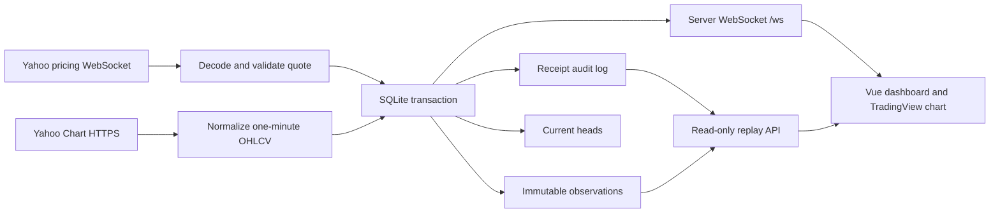

# Data flow and SQLite design

## Architecture

There is one Python FastAPI process, one SQLite writer, and one same-origin HTTP/WebSocket server. FastAPI hosts the API/WebSocket and production Vue assets. In development, Vite serves Vue and proxies `/api` and `/ws` to FastAPI on port 8000. Node is only frontend tooling, a launcher, and an independent evidence client. SQLite is local disk storage, not an in-memory substitute or browser storage. Vue holds display state only and recovers it from a committed snapshot after reconnecting.

### Two Yahoo channels with different semantics

1. `wss://streamer.finance.yahoo.com/?version=2`: subscribe to the four configured symbols every 15 seconds. A JSON pricing envelope contains base64 Protocol Buffers. Decode `PricingData`, retain Yahoo's millisecond timestamp, validate, commit, then broadcast the quote. The main price follows these messages.
2. `https://query1.finance.yahoo.com/v8/finance/chart/{symbol}`: fetch one-minute OHLCV. Bootstrap with `range=1d`; subsequent requests begin three minutes before the latest stored minute. Serial requests run every 15 seconds without overlapping polling cycles; timeout is 10 seconds. These snapshots provide candles and corresponding volume, which are committed and pushed over the client WebSocket. This is refreshing live market data, with upstream HTTP polling for candles and upstream WebSocket streaming for quotes.

A quote is not a trade tape. Yahoo's cumulative `dayVolume`, especially crypto's rolling volume, cannot reliably produce one-minute volume. It is retained as quote metadata but never used as candle volume. The displayed quote can lead the last candle close; the UI makes their independent timestamps explicit.

Normalize candle identities to UTC minute starts. Yahoo sometimes appends an unaligned last-price row to a minute already present. Prefer that minute's aligned OHLCV row so an appended zero-volume quote cannot erase genuine volume. Skip null/nonpositive OHLC rows. Preserve missing volume as JSON null, reported zero as zero. Do not synthesize gaps. A fetched minute is complete when its interval end is no later than the request start time; a still-current interval is incomplete. This also completes the last bar of a closed market when a later fetch observes it, without waiting for a new bar. Completeness is persisted with the fetched observation as a revision, not changed by an unsourced UI timer. No provider-finality guarantee is implied: late corrections remain revisions.

## Schema version 1

`npm run db:init` and startup both execute the idempotent [schema](../server/schema.sql). `PRAGMA user_version=1` and `schema_version` document the installed schema. Each connection enables foreign keys, WAL, a 5-second busy timeout, and FULL synchronization. The Python store uses an RLock for the single writer/connection, autocommit outside explicit transactions, and validates a complete batch before `BEGIN IMMEDIATE`; any failure rolls back observation, head, and receipt changes together.

| Table | Primary key | Purpose and key columns |
| --- | --- | --- |
| `schema_version` | `version` | Schema installation timestamp (`installed_at`). |
| `observations` | `id` (AUTOINCREMENT) | Immutable normalized content: `logical_id`, `revision`, `source`, `kind`, `symbol`, `interval`, `source_time`, first `received_at`, `ordering_time`, SHA-256 `payload_hash`, validated `payload_json`. Unique `(logical_id, revision)`. |
| `heads` | `logical_id` | `observation_id` foreign key to accepted content and the greatest accepted request-order watermark `ordering_time`. |
| `receipts` | `id` (AUTOINCREMENT) | Every normalized arrival: `observation_id`, actual `received_at`, request `ordering_time`, `disposition`, and whether this receipt changed the projection (`applied`). Duplicate receipts reference the same immutable observation. |
| `feed_events` | `id` (AUTOINCREMENT) | Channel, state, detail, and local `received_at` for feed transitions. |

`observations_symbol_kind_time` supports symbol/kind/source-time queries. Identity and receipt indexes support revision lookup and audit retrieval. All timestamps are integer UTC epoch milliseconds. JSON fields are not secrets.

Candle `payload_json`: `open`, `high`, `low`, `close`, `volume` (number or null), `complete` (boolean). Quote payload: `price`, `currency`, `dayVolume`, `changePercent`, `exchange`, `marketHours`. The normalizer uses a fixed payload shape; hashing sorts its keys and excludes receipt metadata. Duplicate comparison uses decoded payload equality, so existing JavaScript-written numeric JSON (1) and Python numeric JSON (1.0) compare consistently without rewriting old observations. The schema remains version 1; startup refuses a newer unsupported schema. OHLC ordering, finite positive prices, nonnegative volume, minute alignment, known sources, and safe timestamps are checked in application code. SQLite enforces identity/revision uniqueness, foreign keys, JSON validity, and disposition constraints.

Example identity: `yahoo-chart:candle:BTC-USD:1m:1794078000000`. This identifies the source's minute, not a particular receipt. Quote identities use the symbol and original Yahoo millisecond timestamp with interval `tick`. Yahoo supplies no exchange trade ID or correction sequence, so two differing quote payloads at the same timestamp are arrival-ordered revisions; no claim of trade-level uniqueness is made.

## Source, receipt, and version ordering

- `source_time`: Yahoo quote event time, or a normalized Yahoo candle's minute start. It says when the market observation belongs.
- `received_at`: local time after the message/response arrives. Duplicate arrivals have distinct receipt records even when their observation is identical.
- `ordering_time`: chart request **start** time, or quote receipt time. Yahoo Chart does not expose a trustworthy revision timestamp. A response from an older request cannot supersede a newer snapshot simply because the older request completed later. This local ordering token is not represented as a provider revision timestamp.
- `revision`: local version count for changed content within one logical identity. It describes arrival history, including a preserved superseded observation; therefore the accepted head need not have the largest revision number.

| Arrival | Stored behavior | Visible head / replay behavior |
| --- | --- | --- |
| First content for an identity | New observation v1 and `inserted` receipt | Apply it. |
| Same current payload | `duplicate` receipt referencing existing observation | No new revision or chart volume; advance the watermark if the request is newer. |
| Changed content, newer/equal request order | New immutable revision, `revised` receipt | Apply and replace that identity's visible candle. Equal-order quote corrections use arrival order. |
| Changed content, older request order | New immutable revision, `superseded` receipt | Keep existing head; replay ignores it for projection. |
| Old matching content from an old request | Duplicate historical observation receipt | Keep existing head. |
| Newer snapshot returns to an earlier price/payload | New revision rather than global hash deduplication | Apply the legitimate reversion. |
| An older minute arrives late | Its independent identity is inserted/revised | Sort by source time; never move the latest quote backward. |

All content/receipt/head writes commit before `on_data` invokes broadcast. A failed persistence operation is reported as rejected data and cannot appear on the chart. No SQL endpoint or arbitrary write API is exposed.

## Browser transport and replay

`/ws` sends:

- `snapshot`: last 360 current candles, latest source-time quote, recent receipts for each symbol, feed status, aggregate storage counters.
- `observations`: committed receipts with immutable observation IDs, disposition, `applied`, and storage counters. The UI applies only accepted content while showing duplicate receipts in its ledger.
- `status` and five-second `heartbeat`: server time, channel metadata, and counters. Uvicorn handles protocol ping/pong. Each browser has a bounded 64-message queue and a five-second send deadline. Slow clients are disconnected with 1013 and recover by snapshot. FastAPI endpoint cancellation cancels/awaits its sender/receiver tasks.

The client reconnects to its server every 1.5 seconds after disconnect. Live data remains separate from the replay display. Current candles are sorted by source time; normal last-bar changes call the chart library's incremental `update`; historical corrections or shifted windows use sorted `setData` without duplicated timestamps. Volume and price share a UTC axis.

`GET /api/replay?symbol=BTC-USD&after=0&limit=2000` freezes `until` to the current global last receipt ID. Pass that `until` with every following page; `nextAfter` is a global receipt cursor, not an offset within a symbol. Records include original receipt times, dispositions, `applied`, and immutable content. Folding applied records in receipt order reconstructs the as-observed accepted state; duplicates and superseded revisions remain inspectable. The browser plays at explicit receipts/second, not original wall-clock cadence. Seeking reconstructs the state from the log. No replay operation writes market records. Live collection continues independently.

Other read routes: `/api/health`, `/api/candles?symbol=...`, `/api/receipts?symbol=...`, `/api/events`. Symbol selection is allowlisted (invalid symbols return 400); typed, bounded FastAPI query/body validation rejects invalid pagination/actions with 422. Unknown API routes return JSON 404.

## Freshness and failures

The browser shows live only if its own server socket is connected, the upstream state is streaming, the selected symbol has an actual pricing receipt in the current server session matching its displayed quote, its candle endpoint is available, the selected quote's source timestamp is no older than 60 seconds, and its latest candle is no older than 180 seconds. A newly loaded cached quote alone cannot qualify as live. These thresholds describe observation age, not an exchange-open calendar. Closed US equities remain stale while Saturday crypto can be live. A socket that has connected but has not produced data does not qualify as fresh.

Yahoo stream errors/closure produce explicit degraded/unavailable status and exponential reconnect backoff (1–30 seconds). Chart errors, timeouts, invalid JSON, and HTTP 429 preserve the last records, expose a symbol error, and retry on the next polling cycle. There is no alternate data provider or invented fallback.

Opt-in `POST /api/demo/feed` disconnects/reconnects real Yahoo connections. Disconnect aborts HTTP requests, terminates the upstream socket, blocks polling, increments a connection generation, and marks both sources unavailable. Responses from a prior generation are discarded. Reconnection is idempotent and resumes actual collection. The browser socket and database remain available during the demonstration. These controls are disabled by default and reject cross-origin requests.

## Boundaries

No credentials are needed. Startup and documentation never print environment secrets. The repository ignores `.env` and local database/WAL files. This single-user loopback application does not implement production identity, TLS termination, horizontal writers, tick completeness, scheduled retention, or a full exchange calendar. Future schema changes need explicit migrations; do not delete a user's records to change the schema. Recent-overlap polling may miss older corrections until a new full backfill. See [verification](verification.md) for evidence and remaining limitations.

## Required-stack migration and disclosure

The initial React/Express approach was replaced after the user supplied the overview's Vue/FastAPI requirement. No database reset was performed. [Migration preservation evidence](../evidence/migration-preservation.json) compares all original columns of previously captured immutable rows and checks schema/integrity. The current FastAPI process uses Python websockets and yfinance's pricing protobuf to decode the same Yahoo protocol; certificate and hostname verification remain enabled using certifi roots. [AI-USE.md](../AI-USE.md) and the [curated process log](evidence-log.md) record the revised approach, first-run TLS/test failures, code decisions, verification, and limitations.
